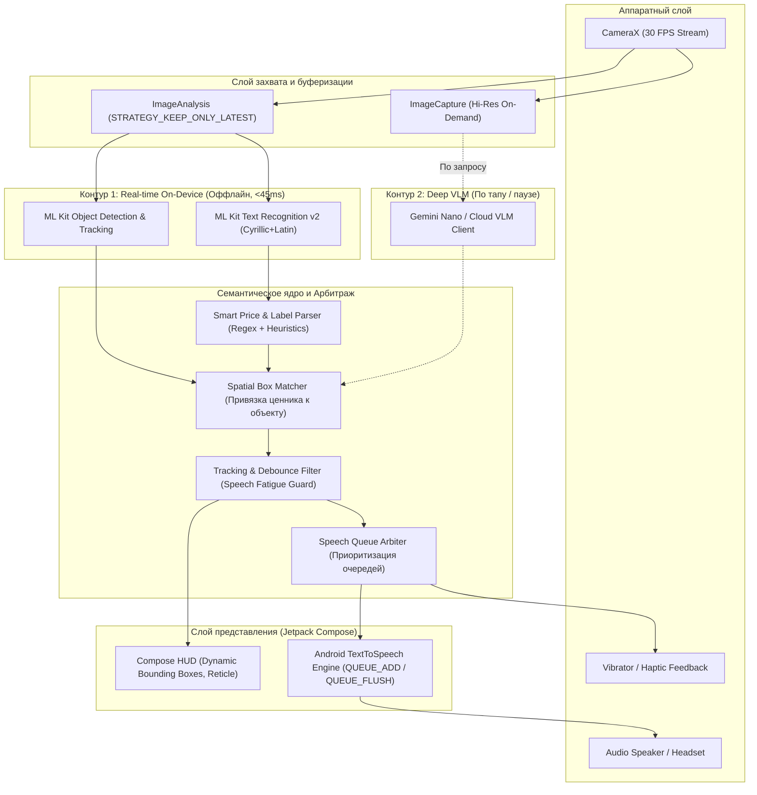

# Архитектура проекта «Glazok» (Assistive Vision & Smart Price Scanner)

Документ поддерживается в актуальном состоянии Мультиагентным Оркестратором (`@Architecture-Guardian`).

---

## 1. Обзор архитектуры (C4 Component Diagram)

Приложение построено по принципам Clean Architecture + MVI/MVVM на базе Jetpack Compose и реактивных потоков Kotlin Flow.



---

## 2. Двухуровневый гибридный пайплайн (Two-Tier Pipeline)

### Контур 1: Real-time On-Device (Мгновенный оффлайн-отклик)
- **Целевая частота инференса:** 10–15 кадров/сек при 30 fps видоискателя.
- **Детектор объектов:** ML Kit Object Detection в режиме `STREAM_MODE`. Генерирует стабильные `trackingId` для удерживаемых в кадре предметов.
- **Распознавание текста:** ML Kit Text Recognition v2 с подключенными языковыми моделями (Кириллица + Латиница). Запускается с пространственной фильтрацией по центральной зоне (Center ROI).

### Контур 2: Deep VLM (Глубокий анализ по запросу)
- **Триггер:** Двойной тап по экрану, длинное удержание или стабилизация камеры на объекте дольше 2 секунд.
- **Действие:** Захват полноразмерного несжатого кадра через `ImageCapture` и передача локальной компактной VLM (Gemini Nano) либо внешнему облачному VLM API.
- **Результат:** Развернутое описание состава, предупреждения об аллергенах, срок годности, расширенный контекст.

---

## 3. Семантическое ядро: Умный парсер ценников и этикеток

### Логика работы `SmartPriceParser`
1. **Токенизация:** Выделение всех блоков текста и их сортировка по геометрической близости (кластеризация строк ценника).
2. **Фильтрация шума:** Отсечение артикулов, штрихкодов, дат изготовления и служебных кодов кассы.
3. **Паттерны распознавания цен:**
   - Форматы: `XXX ₽`, `XXX руб.`, `XXX.YY`, `X XXX р`.
   - Иерархия цен:
     - *Акционная цена:* крупный шрифт, маркеры «по карте», «акция», желтый/красный фон.
     - *Базовая цена:* меньший размер шрифта, перечеркивание, маркер «без карты».
   - Единицы измерения: `за шт`, `за 100 г`, `за 1 кг`, `от 2 шт`.
4. **Синтез речевой фразы:**
   - Пример: `«Шоколад Алёнка. Цена по карте: 89 рублей. Без карты: 119 рублей за штуку»`.

---

## 4. Контракты предметной области (Domain Model Contracts)

Ниже зафиксированы спецификации основных структур данных:

### `BoundingBoxRect`
```kotlin
// Геометрический прямоугольник в нормализованных координатах [0.0 .. 1.0]
data class BoundingBoxRect(
    val left: Float,
    val top: Float,
    val right: Float,
    val bottom: Float
)
```

### `RecognizedObject`
```kotlin
data class RecognizedObject(
    val trackingId: Int?,
    val label: String,
    val confidence: Float,
    val boundingBox: BoundingBoxRect,
    val associatedPrice: PriceTag? = null
)
```

### `PriceTag`
```kotlin
data class PriceTag(
    val mainPrice: Double,
    val originalPrice: Double? = null,
    val isLoyaltyPrice: Boolean = false,
    val unitOfMeasure: String? = null, // "кг", "шт", "100г"
    val boundingBox: BoundingBoxRect,
    val rawText: String
)
```

### `SpeechTask`
```kotlin
enum class SpeechPriority {
    CRITICAL,   // Препятствие, потеря фокуса (QUEUE_FLUSH)
    TARGET_LOCK,// Найден ценник / центральный объект (QUEUE_ADD с приоритетом)
    BACKGROUND  // Дополнительная инфо (QUEUE_ADD)
}

data class SpeechTask(
    val id: String,
    val utterance: String,
    val priority: SpeechPriority,
    val triggerHaptic: Boolean = true
)
```

---

## 5. Защита от перегрузки (Speech Fatigue & Camera Backpressure)

1. **CameraX Backpressure:** Использование строго `ImageAnalysis.STRATEGY_KEEP_ONLY_LATEST`. Если детекция занимает больше времени, промежуточные кадры автоматически отбрасываются ОС.
2. **Time-To-Live (TTL) и Дедупликация:**
   - Если объект с `trackingId = N` уже озвучен, он помещается в кэш озвученных объектов на 5 секунд.
   - Повторная озвучка разрешена только при изменении ассоциированной цены или исчезновении объекта из кадра более чем на 2 секунды.
3. **Тактильный индикатор наведения (Haptic Reticle):**
   - При совпадении центра экрана с Bounding Box ценника выдается короткий импульс `HapticFeedbackConstants.CONFIRM`.
